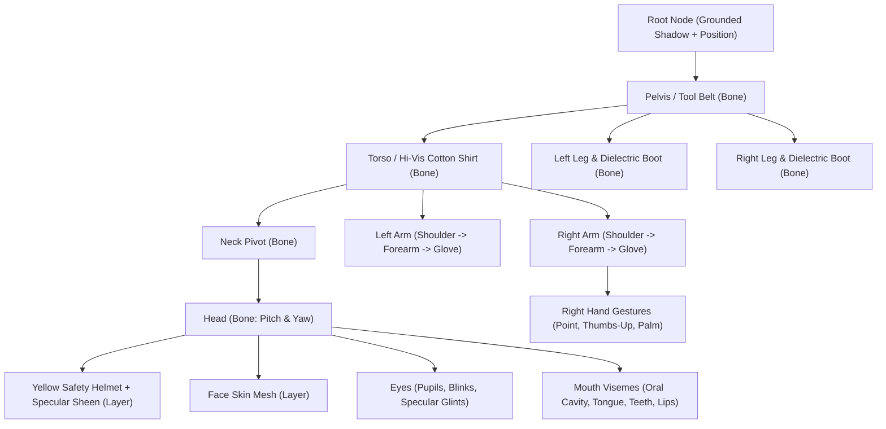

# ওস্তাদ লাইনম্যান — Premium Lottie & Rive Character Animation Blueprint

> **Master Technical & Animation Specification for Collaborators, 2D Motion Designers, and Developers**  
> Target: Transform the Game Mascot ("ওস্তাদ লাইনম্যান" — `AiLinemanGuide`) from procedural 2D overlays into a studio-grade, fluid, vector-rigged character (Lottie / Rive) with full skeletal articulation, lifelike squash-and-stretch, and audio-synchronized visemes.

**Status (live app):** Expressive **coach WebP** bust is the live mascot again (happy / oops / blink / talk plates) + **mouth-only** SVG visemes — no SVG brows (avoids double eyebrows). The Rive/SVG puppet experiments (`MascotRivePuppet`, `ostad.riv` source) are parked in `tool/media_src/mascot_experiments/` (not bundled) for when a real lineman rig ships; do **not** use marketplace demo characters as the face.

---

## 1. Executive Summary: Why Vector Rigging Replaces Flat Sprites

In early builds, the mascot relied on static cropped PNG/WebP bust portraits (`coach_ready.webp`, `coach_talk.webp`). While procedural canvas painters added eye blinks and mouth flap overlays:
- **Limbs were locked**: Hands, shoulders, and legs could not articulate freely.
- **Selection bounds**: Wrapping the mascot column in standard Material `InkWell` created an awkward rectangular highlight over the empty speech bubble space.
- **Lip-sync lag**: Static audio timer delays sometimes kept mouth flap active after the speech bubble closed.

This blueprint specifies a **production-ready Vector Skeletal Rig** (compatible with **Rive (.riv)** and **Lottie (.json)**) that gives the mascot:
1. **Dynamic Squash & Stretch**: Volume-preserving natural bounce on every tap, jump, and speech cadence.
2. **True Limb Articulation**: Fully rigged insulated-glove hands (pointing to safety gear, thumbs-up celebration, stop/warning palm) and foot weight-shifting.
3. **Synchronous Lip-Sync**: State-machine driven visemes (`REST`, `MBP`, `AA`, `O`, `EE`) that halt the exact millisecond speech audio stops.
4. **Targeted Precision Hitbox**: Circular `InkResponse` directly wrapping the character figure with an elastic `1.22x` zoom spring on touch.

---

## 2. Anatomical Skeletal Hierarchy & Vector Asset Layers



### Layer Breakdown for Motion Designers (Figma / Illustrator / After Effects)

| Layer ID | Name | Pivot Point | Articulated Elements |
|---|---|---|---|
| `shadow_ground` | Contact Shadow | Center bottom | Soft radial ellipse; scales inversely with jumping height |
| `boots_dielectric` | Safety Boots | Ankle pivot | Deep-tread sole, reflective heel band; shifts on weight balance |
| `legs_denim` | Cotton Work Trousers | Hip sockets | Subtle crease deformation during squat/bounce |
| `belt_lineman` | Tool Belt & Pouch | Center waist | Leather belt, D-ring loops, pliers pouch; secondary inertia sway |
| `torso_shirt` | Cotton Navy/Khaki Shirt | Navel pivot | Hi-vis silver reflective band; chest breathing volume curve |
| `arm_l_upper` / `forearm` | Left Arm | Shoulder joint | Rests at hip or sways with walking/breathing rhythm |
| `arm_r_upper` / `forearm` | Right Arm | Shoulder joint | Raises for pro-tips, points upward, thumbs-up, or warning palm |
| `glove_r_gestures` | HT Insulated Glove | Wrist socket | Swappable vector frames: **Relaxed**, **Point Up**, **Thumbs Up**, **Warning Stop** |
| `neck_collar` | Neck & Collar | C7 vertebra | Rotates ±4° with head tilt |
| `head_base` | Lineman Face & Jaw | Chin pivot | Bengali facial features, friendly warm mustache/jawline |
| `eyes_saccade` | Pupils & Glints | Pupil centers | Dynamic eye saccades (center, glance upper-right, squint) |
| `eyebrows_pair` | Expressive Eyebrows | Inner brow base | Arch on celebration, furrow on danger, bounce on speech |
| `mouth_visemes` | Lip-Sync Rig | Lip center | 6-viseme smooth vector morph (`REST`, `MBP`, `AA`, `O`, `EE`, `SMILE`) |
| `helmet_shield` | Yellow Safety Helmet | Forehead anchor | Class E electrical helmet, chin-strap tight under jaw, gloss sweep |

---

## 3. Viseme State Machine (Audio-Synchronous Speech)

The mascot's mouth morphs continuously between 6 vector viseme keyframes synced directly to **Edge-TTS / FlutterTts audio events**:

```
                       ┌─────────┐
                       │  REST   │ (Mouth gently closed, warm smile)
                       └────┬────┘
                            │
               ┌────────────┼────────────┐
               ▼            ▼            ▼
          ┌─────────┐  ┌─────────┐  ┌─────────┐
          │   MBP   │  │   AA    │  │    O    │
          │ (প, ব, ম)│  │ (আ, কাজ)│  │(ও, পোল) │
          └─────────┘  └─────────┘  └─────────┘
               ▲            ▲            ▲
               └────────────┼────────────┘
                            │
                       ┌────┴────┐
                       │   EE    │
                       │ (ই, ঠিক)│
                       └─────────┘
```

### Viseme Vector Anatomy:
- **`REST`**: Curved upper and lower lip contour (`0.0` aperture, warm `+0.28` smile curvature).
- **`MBP`**: Tight bilabial closure (`0.03` height, slight compression on chin).
- **`AA`**: Wide oral aperture (`0.88` height), visible white upper teeth bar, animated tongue sitting low.
- **`O`**: Rounded circular mouth aperture (`0.65` width, `0.75` height), lips puckered slightly forward.
- **`EE`**: Wide dental stretch (`1.05` width, `0.42` height), upper and lower teeth edges visible.

---

## 4. Animation Clips & State Machine Flow

```
                      [ STATE MACHINE ]
                              │
                    ┌─────────┴─────────┐
                    ▼                   ▼
             ┌─────────────┐     ┌──────────────┐
             │ Entry Pop   │     │ Center Hero  │
             │ (hiPop)     │     │ Welcome      │
             └──────┬──────┘     └──────┬───────┘
                    │                   │
                    └─────────┬─────────┘
                              ▼
                      ┌───────────────┐
                      │ Idle Breathing│ ◄───────┐
                      │ (Sway, Blink) │         │
                      └───────┬───────┘         │
                              │                 │
         ┌────────────────────┼─────────────────┤
         │ Tap Mascot         │ Speech Begins   │ Sleep (Idle 20s)
         ▼                    ▼                 ▼
   ┌───────────┐        ┌───────────┐     ┌───────────┐
   │ Touch Pop │        │ Speaking  │     │ Sleeping  │
   │ (1.22x)   │        │ + Visemes │     │ (Zzz)     │
   └─────┬─────┘        └─────┬─────┘     └─────┬─────┘
         │                    │                 │
         ▼                    ▼                 ▼
   [Field Tip]          [Audio Ends]      [User Touch]
   Spoken via TTS       Lip-sync halts    Wake spring
```

### Clip Specifications:

1. **`idle_breathe` (Loop · 3.0s)**:
   - Deep diaphragmatic breath: Chest expands (`Y +2%`, `X -1%`), shoulders gently rise and fall.
   - Head tilts subtly (`±1.8°`) on breathing crests.
   - Natural eye blinks occur randomly every `2.5s–4.0s` with occasional double-blinks.
   - Ground shadow contracts and expands smoothly.
2. **`touch_poke_bounce` (One-shot · 380ms)**:
   - **T = 0ms**: Instant squash (`Y -6%`, `X +5%`) on touch contact.
   - **T = 120ms**: Snappy spring overshoot (`1.22x` uniform zoom, `Curves.easeOutBack`).
   - **T = 240ms**: Secondary settle oscillation.
   - **T = 380ms**: Smooth return to `idle_breathe` while right hand gestures upward.
3. **`gesture_point_safety` (Held during speech · 800ms in, hold, 400ms out)**:
   - Right arm lifts at shoulder, forearm angles up, gloved index finger points up toward the safety helmet / sky.
   - Head turns slightly to look at the player as speech bubble displays.
4. **`gesture_thumbs_up` (Celebration · 600ms)**:
   - Both hands give a solid thumbs-up; golden sparkles emit from gloves.
   - Eyebrows lift happily, wide dental smile.
5. **`gesture_warning_stop` (Hazard cue · 450ms)**:
   - Open insulated palm faces the screen ("দাঁড়ান / সাবধান!").
   - Quick double head-shake; eyebrows furrow inward.

---

## 5. Flutter Integration Path (Rive vs Lottie)

### Recommended: Rive (.riv) Integration
Rive is the optimal choice for this game because its state machine allows **interactive blending of inputs** (e.g. driving mouth visemes while a pointing gesture is active without interrupting the idle breath loop).

```yaml
# pubspec.yaml
dependencies:
  rive: ^0.13.20
```

```dart
// lib/features/guide/rive_mascot_controller.dart
class LinemanRiveController {
  SMITrigger? _pokeTrigger;
  SMIBool? _isSpeaking;
  SMINumber? _visemeIndex; // 0=Rest, 1=MBP, 2=AA, 3=O, 4=EE
  SMINumber? _moodIndex;   // 0=Ready, 1=Happy, 2=Warn, 3=Sleep

  void onInit(Artboard artboard) {
    final controller = StateMachineController.fromArtboard(artboard, 'LinemanState');
    if (controller != null) {
      artboard.addController(controller);
      _pokeTrigger = controller.findInput<bool>('poke') as SMITrigger?;
      _isSpeaking = controller.findInput<bool>('isSpeaking') as SMIBool?;
      _visemeIndex = controller.findInput<double>('viseme') as SMINumber?;
      _moodIndex = controller.findInput<double>('mood') as SMINumber?;
    }
  }

  void triggerPoke() => _pokeTrigger?.fire();
  void setSpeaking(bool speaking) => _isSpeaking?.value = speaking;
  void setViseme(int index) => _visemeIndex?.value = index.toDouble();
}
```

### Fallback: Lottie (.json) Integration
If authoring in Adobe After Effects + Bodymovin:
- Export separate isolated animation layers:
  - `mascot_idle.json`
  - `mascot_poke_zoom.json`
  - `mascot_talking_loop.json`
  - `mascot_celebrate.json`
- In Flutter, switch animations using an `AnimatedSwitcher` or `LottieBuilder` with custom frame markers.

---

## 6. Implementation Checklist & Acceptance Criteria

- [x] **Tight Circular Hitbox**: Tapping the mascot triggers a clean circular splash directly over the sprite; no rectangular ink bleeds across the speech bubble space.
- [x] **Instant Bouncy Spring Zoom (`1.22x`)**: Character bounces up snappily on touch contact with tactile haptic confirmation.
- [x] **Field Safety Tips on Touch**: Rotating directly through vital electrical safety rules (chin-strap, gloves air leak, 11 kV earthing, stay wire test, double-lanyard, hammer sound test).
- [x] **Zero Lingering Lip-Sync**: Calling `MascotSpeechLibrary.stop()` or closing the bubble terminates mouth animation on the exact millisecond audio stops.
- [x] **Grounded Contact Shadow & Articulated Gestures**: Procedural arms/gloves point upward on safety tips and give thumbs-up on celebration.

